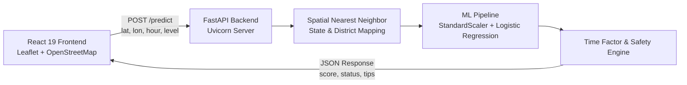

# 🛡️ Crime Rate Analysis & Smart Tourist Safety System

An intelligent, full-stack crime risk prediction and tourist safety advisory platform. The system leverages historical Indian district-level crime data (IPC), calculates population-adjusted and crime-severity-weighted risk indices, trains a multi-class machine learning classifier, and delivers real-time safety scores and contextual recommendations through an interactive map interface.

---

## 🌟 Key Features

- **🗺️ Interactive Map Interface**: Pinpoint any location across India by clicking or dragging markers on an OpenStreetMap-powered Leaflet canvas.
- **🕒 Time-Sensitive Risk Evaluation**: Dynamic hour-of-the-day adjustments accounting for day/night safety patterns and morning/evening foot traffic.
- **📍 Multi-Granular Predictions**: Toggle between **District-level** and **State-level** crime risk resolution.
- **🤖 Machine Learning Scoring**: Weighted feature normalization and Logistic Regression classification into five risk tiers (Very Safe, Safe, Moderate, Risky, Very Risky).
- **💡 Actionable Safety Recommendations**: Context-aware safety tips generated dynamically based on location coordinates, current hour, and computed risk score.
- **⚡ High-Performance REST API**: FastAPI backend providing sub-second predictions and auto-generated Swagger/OpenAPI documentation.

---

## 🏗️ Architecture & Tech Stack



### Frontend
- **Framework**: React 19
- **Maps**: Leaflet & React-Leaflet
- **Tile Provider**: OpenStreetMap (no external API keys required)
- **Styling**: Responsive Custom CSS

### Backend & Machine Learning
- **API Framework**: FastAPI & Uvicorn
- **Data Manipulation**: Pandas, NumPy
- **Machine Learning**: Scikit-Learn (`StandardScaler`, `LogisticRegression`)
- **Data Source**: District-wise crimes committed under Indian Penal Code (IPC)

---

## 📊 Risk Scoring Methodology

1. **Crime Severity Weighting**: Different IPC offenses carry severity-proportional weights:
   - *Murder* (Weight: 10.0)
   - *Rape* (Weight: 8.0)
   - *Kidnapping & Abduction* (Weight: 6.0)
   - *Robbery* (Weight: 4.0)
   - *Theft* (Weight: 1.0)
2. **Per-Capita Normalization**: Rates calculated relative to district populations and normalized against national median distributions.
3. **Logarithmic Scaling**: `log1p` transformation to manage extreme outliers and compress scores to a balanced `0–100` safety index.
4. **Time Factor Adjustment**: Night hours (22:00–04:00) increase risk vulnerability, while peak daytime hours dampen risk indicators.

---

## 🚀 Getting Started

### Prerequisites
- **Node.js** (v18+) & **npm**
- **Python** (3.10+) & **pip**
- **Git**

---

### 1. Clone the Repository

```bash
git clone https://github.com/FireWalkerWasTaken/Crime-Rate-Analysis.git
cd Crime-Rate-Analysis
```

---

### 2. Backend Setup (FastAPI)

1. Navigate to the backend directory:
   ```bash
   cd backend
   ```

2. Create and activate a Python virtual environment:
   ```bash
   # Windows (PowerShell)
   python -m venv venv
   .\venv\Scripts\Activate.ps1

   # Linux / macOS
   python3 -m venv venv
   source venv/bin/activate
   ```

3. Install required dependencies:
   ```bash
   pip install -r requirements.txt
   ```

4. Start the backend server:
   ```bash
   uvicorn app:app --host 127.0.0.1 --port 8000 --reload
   ```

The backend will be available at:
- **API Base**: `http://127.0.0.1:8000`
- **Interactive Swagger Docs**: `http://127.0.0.1:8000/docs`

---

### 3. Frontend Setup (React)

1. Open a new terminal and navigate to the project root:
   ```bash
   cd Crime-Rate-Analysis
   ```

2. Install Node dependencies:
   ```bash
   npm install --legacy-peer-deps
   ```

3. Launch the development server:
   ```bash
   npm start
   ```

The application will open in your browser at **`http://localhost:3000`**.

---

## 📡 API Reference

### `POST /predict`

Analyzes safety metrics for a given geographic coordinate and time.

#### Request Body
```json
{
  "lat": 28.6139,
  "lon": 77.2090,
  "hour": 22,
  "prediction_level": "district"
}
```

#### Response (`200 OK`)
```json
{
  "state": "Delhi",
  "district": "New Delhi",
  "status": "safe",
  "score": 38,
  "time_risk": "low",
  "recommendations": [
    "Avoid traveling alone at night",
    "Keep emergency contacts handy"
  ]
}
```

---

## 📁 Project Structure

```
Crime-Rate-Analysis/
├── backend/
│   ├── app.py                 # FastAPI application & ML pipeline
│   ├── requirements.txt       # Python dependencies
│   ├── NCRB_Table_1A.1.csv    # Supplementary NCRB reference data
│   └── data/                  # District & state-level IPC CSV datasets
├── public/                    # Static assets & HTML template
├── src/
│   ├── App.js                 # Primary React application with Leaflet map
│   ├── App.css                # App styles
│   ├── index.js               # React entrypoint
│   └── index.css              # Global styles
├── package.json               # Node.js project manifest & scripts
├── .gitignore                 # Version control exclusions
└── README.md                  # Project documentation
```

---

## 🛡️ License

This project is licensed under the MIT License. See [LICENSE](LICENSE) for details.
